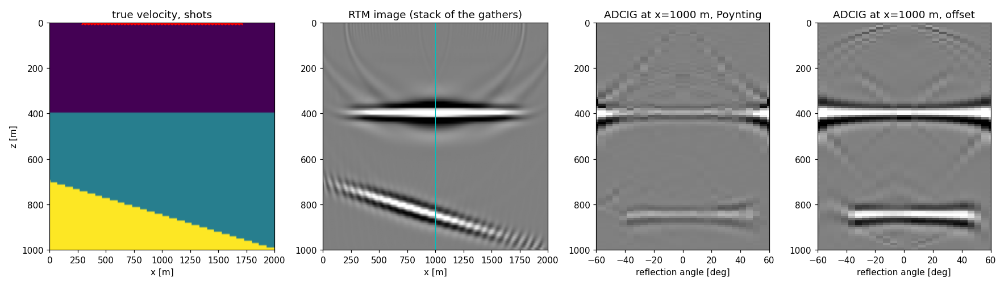

# rtmcig

**GPU reverse-time migration of prestack seismic data to angle-domain common-image gathers (ADCIGs).**

English | [简体中文](README.zh-CN.md)

Wave propagation is [Deepwave](https://github.com/ar4/deepwave)'s (staggered-grid / regular-grid
finite differences with C-PML absorbing boundaries, prebuilt CPU and CUDA kernels); the imaging
conditions, the angle decomposition and the memory management are PyTorch. Same conventions as
[kirchcig](https://github.com/zzzzswh/kirchcig): positions in metres, data `(ns, nr, nt)`,
gathers `(nh, nx, nz)`.



<sub>`python examples/layered_model.py`: 48 shots, a flat and a dipping interface, migration with a
smoothed velocity. Left to right: true velocity, RTM image (the stack of the gathers), the ADCIG at
x = 1000 m from the Poynting method and from the offset method.</sub>

## Install

```bash
pip install torch                       # pick the CUDA build for your driver from pytorch.org
pip install rtmcig                      # pulls in deepwave (prebuilt CPU+CUDA wheel) and numpy
# or, from a checkout:  pip install -e .
```

No compiler needed: Deepwave ships prebuilt CPU and CUDA kernels. `pip install "rtmcig[test]"` adds `pytest`; `pytest -q` runs in about a
minute on the CPU.

## Quick start

```python
import numpy as np
from rtmcig import migrate

# data  (ns, nr, nt)   prestack traces (reflections; mute the direct wave first)
# vel   (nx, nz)       migration velocity [m/s]
# srcs  (2, ns)        source positions, rows are (x, z) [m]
# recs  (2, nr)        receiver positions, rows are (x, z) [m]; or (ns, 2, nr), NaN = dead trace

adcig = migrate(
    data, vel, srcs, recs,
    dt=0.002, dx=10.0, dz=10.0,
    f0=20.0,                   # peak frequency of the Ricker source wavelet
    nh=30, hmax=60.0,          # 30 reflection-angle bins, 0-60 degrees
)
# adcig -> (30, nx, nz);  adcig.sum(0) is the RTM image
```

No data at hand:

```python
from rtmcig import RTMCIG
op = RTMCIG.demo()               # two-layer model, 5 shots, 51 receivers
adcig = op.migrate(op.demo_data())
image = op.image                 # (nx, nz)
```

## The operator

```python
op = RTMCIG(
    vel, dx, dz, srcs, recs, nt, dt,
    wavelet=None, f0=20.0,      # (nt,) or (ns, nt) source wavelet, or a Ricker of peak frequency f0
    nh=30, hmax=60.0,           # angle axis: nh bins between 0 (or -hmax) and hmax degrees
    signed=False,               # True: -hmax..hmax, positive = source on the -x side
    method="poynting",          # or "offset"
    equation="scalar",          # or "acoustic" (staggered grid, needs rho)
    image_dt=None,              # imaging interval, a multiple of dt (default dt)
    halfderiv=False,            # 2D phase correction, see below
    illumination=False,         # source-illumination compensation (True -> eps = 0.01)
    laplacian=False,            # -laplacian filter against low-wavenumber artefacts
    aperture=None, cig_x=None,  # lateral window [m]; output columns [m]
    shot_batch="auto", store="device", store_dtype="float16",   # memory, see below
    interpolation="nearest",    # or "hicks" for sub-cell positions
    pml_width=20, free_surface=False, accuracy=4,
    device="auto", dtype="float32", verbose=False,
)
adcig = op.migrate(data)         # (nh, n_cig, nz); NumPy in, NumPy out; tensor in, tensor out
op.image, op.illumination_map    # (nx, nz)
op.angles, op.x, op.z            # axes
data = op.model(v_true)          # forward modelling with the same geometry -> (ns, nr, nt)
```

| Object | Shape | Notes |
|---|---|---|
| `data` | `(ns, nr, nt)` | float32; dead traces (`NaN` positions) are ignored |
| `vel`, `rho` | `(nx, nz)` | metres per second, kg/m^3; a scalar with `nx=`, `nz=` also works |
| `srcs` | `(2, ns)` | rows `(x, z)` in metres |
| `recs` | `(2, nr)` or `(ns, 2, nr)` | one spread, or a spread per shot |
| `adcig` | `(nh, nx, nz)` | or `(nh, len(cig_x), nz)`; `.sum(0)` is the image |
| `op.odcig` | `(2*offsets+1, nx, nz)` | subsurface-offset gathers, `method="offset"` only |

### Two ways to the angle

`method="poynting"` (default) decomposes every imaging step by the propagation directions of the
two wavefields, `P = -u_t grad(u)` (or `p v` for the acoustic engine), smoothed over a quarter
wavelength (`poynting_smooth`): `theta = 1/2 atan2(n_s x n_r, n_s . n_r)` (Yoon & Marfurt 2006).
It costs a few elementwise passes per step and the gathers sum *exactly* to the image. Its known
limitation: at the reflection point the back-propagated arrivals of every receiver in the Fresnel
zone overlap, so the receiver-side direction is the energy-weighted mean of a range of directions
and the event lands a few degrees outside the geometric angle (several degrees for a reflector a
few hundred metres deep under a spread of kilometres, less at depth; the bias scales like
`sqrt(wavelength / depth)`).

`method="offset"` accumulates the subsurface-offset extended image
`I(x, z, h) = sum_t u_s(x-h) u_r(x+h)` over `2*offsets+1` half-offsets and slant-stacks it to angle
in the Fourier domain (Sava & Fomel 2003). Accurate to a degree or two in the tests, at the cost
of `2*offsets+1` multiply-adds per imaging step and an `(nho, nx, nz)` intermediate that is kept as
`op.odcig`. The slant stack is normalised by the number of offsets, so a focused event has the
image's amplitude at its angle.

Both give signed angles with `signed=True` (positive: source on the -x side of the reflection
point); `fold_angles` folds a signed gather to `|theta|`.

### Two propagators

`equation="scalar"`: `deepwave.scalar`, the constant-density wave equation on a regular grid. One
field, the default. `equation="acoustic"`: `deepwave.acoustic`, the variable-density
velocity-pressure system on a staggered grid, `rho` required, Poynting vector `p v`. The acoustic
engine injects `-(1/rho) int f dt` so that it records the same data and produces images of the
same phase, polarity and scale as the scalar one (they agree to 0.99 in the tests); for a constant
density the two are interchangeable. Both use Deepwave's C-PML (`pml_width` cells, tuned at `f0`),
`accuracy` 2-8 spatial order, and Deepwave's automatic CFL sub-stepping. `free_surface=True`
makes the top a pressure-free boundary.

### Phase and polarity in 2D: `halfderiv`

In two dimensions a specular reflection is one cylindrical Green's function, whose 45-degree
phase and `|omega|^-1/2` spectrum are not cancelled by the back-propagation, so the plain 2D RTM
wavelet is rotated by 45 degrees and tilted to low frequencies. `halfderiv=True` applies
`conj(sqrt(1 - rho e^{-i omega}))`, the adjoint half-order time derivative (`sf_halfint`, the
same filter and convention as `kirchcig`), to the data before migration; the imaged wavelet is
then zero-phase and centred on the reflector. Polarity: a velocity increase images as a
**positive** peak for data modelled by `op.model` (or Deepwave) with the same wavelet.

### Memory and speed

The source wavefield is stored between the forward and the backward pass; that is what costs
memory. `op.snapshot_bytes(shots)` says how much.

- `store_dtype="float16"` (default) scales every snapshot of every shot by its maximum before
  rounding: 2 bytes per cell, 1e-3 relative accuracy (the gathers agree with a float32 store to
  1e-3 in the tests). `"bfloat16"`: 2 bytes, no scaling. `"float32"`: exact. The Poynting method
  adds an int16 direction (2 bytes).
- `image_dt=k*dt` samples the imaging condition every `k` steps; the cross-correlation only needs
  the Nyquist rate of the data, so 2-4 is usually safe and divides memory and imaging work by `k`.
- `store="cpu"` keeps the snapshots in pinned host memory and streams them over PCIe on a side
  stream, double-buffered, while the imaging kernels run.
- `shot_batch="auto"` propagates as many shots together as fit into `memory_fraction` of the free
  device memory (Deepwave batches shots in one kernel launch), and switches to the host store when
  one shot does not fit. On the CPU one shot per thread.
- `aperture` [m] restricts each batch to the columns around its shots and live receivers; sort
  the shots along the line so that batched shots share a window. `cig_x` outputs gathers only at
  the given positions (the image is always full).

### Geometry

Positions are metres; the grid is `x = ox + ix*dx`, `z = oz + iz*dz`. `interpolation="nearest"`
rounds to the nearest cell; `"hicks"` injects and records at the exact sub-cell position with
Kaiser-windowed sinc interpolation (Hicks 2002, `hicks_halfwidth`). Receivers that round to the
same cell are summed before injection. `NaN` positions are dead traces. Receiver spreads per shot:
`recs` of shape `(ns, 2, nr)`.

### Modelling

`op.model(v_true, rho=None, wavelet=None, max_vel=None)` records data with the operator's
geometry. To make reflection-only data, subtract the direct wave modelled in the background:
model both with the same `max_vel` so that Deepwave uses the same internal time step (the demo
does). `op.demo()`, `op.demo_data()` and `op.demo_true_velocity()` set up a two-layer example.

## Tests, examples, benchmark

```bash
pip install -e ".[test]"
pytest -q                                   # ~1 min on one CPU core
python examples/plot_adcig.py               # the demo, plotted
python examples/two_methods.py              # Poynting vs offset gathers at one location
python examples/layered_model.py            # the README figure
python benchmarks/bench.py                  # ms per shot on your device
```

The tests check: the gathers sum to the image; the reflector is imaged at the right depth with
the right polarity; the zero-offset wavelet is zero-phase with `halfderiv`; the angles follow the
geometry for both methods and both engines; signed folds to unsigned; batching, aperture,
`cig_x`, the store dtypes, the host store and `image_dt` do not change the answer beyond their
stated tolerances; dead traces equal zeroed traces; duplicate receivers are summed; Hicks and
per-shot spreads run; the two engines agree.

## Limitations

- 2D only. Deepwave propagates 3D, the imaging code here is written for `(nz, nx)` fields.
- Acoustic (no elastic, no P/S separation), isotropic.
- No demigration and no exact adjoint pair: RTM is the adjoint of Born modelling, which would be
  the natural next step for least-squares migration.
- The Poynting angles carry the method's crosstalk bias (see above); use `method="offset"` when
  AVA-grade angles matter.

## References

- Yoon, K. & Marfurt, K. J., 2006. Reverse-time migration using the Poynting vector. *Exploration Geophysics* 37, 102-107.
- Sava, P. & Fomel, S., 2003. Angle-domain common-image gathers by wavefield continuation methods. *Geophysics* 68, 1065-1074.
- Hicks, G. J., 2002. Arbitrary source and receiver positioning in finite-difference schemes using Kaiser windowed sinc functions. *Geophysics* 67, 156-166.
- Richardson, A., 2023. Deepwave. https://github.com/ar4/deepwave
- Pasalic, D. & McGarry, R., 2010. Convolutional perfectly matched layer for isotropic and anisotropic acoustic wave equations. *SEG Expanded Abstracts*.

<sub>Keywords: reverse-time migration, RTM, angle-domain common-image gather, ADCIG, angle gather, Poynting vector, subsurface offset, extended imaging condition, slant stack, GPU seismic imaging, PyTorch, Deepwave, migration velocity analysis, AVA.</sub>
