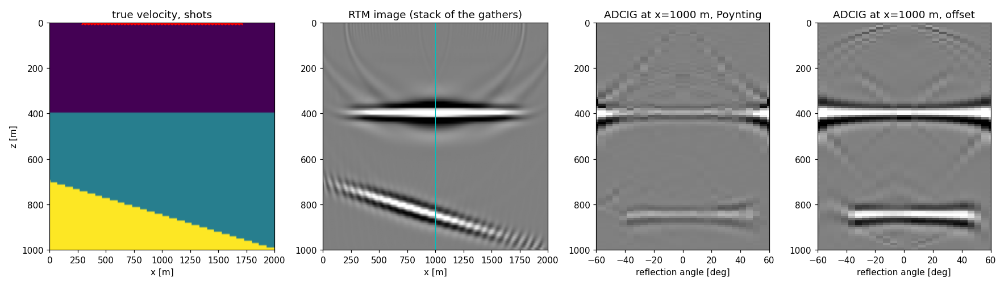

# rtmcig

**基于 GPU 的叠前逆时偏移（RTM）→ 角度域共成像点道集（ADCIG）。**

[English](README.md) | 简体中文

波场传播由 [Deepwave](https://github.com/ar4/deepwave) 完成（交错网格 / 规则网格有限差分 + C-PML 吸收边界，
预编译的 CPU 与 CUDA 核）；成像条件、角度分解与内存管理用 PyTorch 实现。约定与
[kirchcig](https://github.com/zzzzswh/kirchcig) 相同：坐标单位为米，数据 `(ns, nr, nt)`，道集 `(nh, nx, nz)`。



<sub>`python examples/layered_model.py`：48 炮，一个水平界面和一个倾斜界面，用平滑速度偏移。从左至右：真实速度、
RTM 成像（道集叠加）、Poynting 方法与偏移距方法在 x = 1000 m 处的 ADCIG。</sub>

## 安装

```bash
pip install torch                       # 按显卡驱动从 pytorch.org 选择 CUDA 版本
pip install git+https://github.com/zzzzswh/rtmcig.git   # 自动安装 deepwave（预编译 CPU+CUDA wheel）与 numpy
# 或从源码：  pip install -e .
```

rtmcig 尚未发布到 PyPI，请从 GitHub 或源码安装。无需编译器：Deepwave 自带预编译的 CPU 与 CUDA 核。
在源码目录中 `pip install -e ".[test]"` 附带 `pytest`（`pytest -q` 在 CPU 上约一分钟跑完），`".[plot]"` 附带示例所需的依赖。

## 快速开始

```python
import numpy as np
from rtmcig import migrate

# data  (ns, nr, nt)   叠前道（反射波；请先切除直达波）
# vel   (nx, nz)       偏移速度 [m/s]
# srcs  (2, ns)        炮点坐标，两行分别为 (x, z) [m]
# recs  (2, nr)        检波点坐标，两行为 (x, z) [m]；也可为 (ns, 2, nr)，NaN 表示坏道

adcig = migrate(
    data, vel, srcs, recs,
    dt=0.002, dx=10.0, dz=10.0,
    f0=20.0,                   # Ricker 子波主频
    nh=30, hmax=60.0,          # 30 个反射角道，0-60 度
)
# adcig -> (30, nx, nz);  adcig.sum(0) 即 RTM 成像
```

没有数据也可以直接跑：

```python
from rtmcig import RTMCIG
op = RTMCIG.demo()               # 两层模型，5 炮，51 道
adcig = op.migrate(op.demo_data())
image = op.image                 # (nx, nz)
```

## 算子

```python
op = RTMCIG(
    vel, dx, dz, srcs, recs, nt, dt,
    wavelet=None, f0=20.0,      # (nt,) 或 (ns, nt) 震源子波，或主频为 f0 的 Ricker
    nh=30, hmax=60.0,           # 角度轴：0（或 -hmax）到 hmax 度之间 nh 个道
    signed=False,               # True：-hmax..hmax，正值表示炮点在反射点 -x 一侧
    method="poynting",          # 或 "offset"
    equation="scalar",          # 或 "acoustic"（交错网格，需要 rho）
    image_dt=None,              # 成像时间间隔，dt 的整数倍（默认 dt）
    halfderiv=False,            # 二维相位校正，见下文
    illumination=False,         # 震源照明补偿（True -> eps = 0.01）
    laplacian=False,            # -laplacian 滤波，压制低波数噪声
    aperture=None, cig_x=None,  # 横向偏移孔径 [m]；输出道集的位置 [m]
    shot_batch="auto", store="device", store_dtype="float16",   # 内存，见下文
    interpolation="nearest",    # 或 "hicks"（亚网格坐标）
    pml_width=20, free_surface=False, accuracy=4,
    device="auto", dtype="float32", verbose=False,
)
adcig = op.migrate(data)         # (nh, n_cig, nz)；NumPy 进 NumPy 出，tensor 进 tensor 出
op.image, op.illumination_map    # (nx, nz)
op.angles, op.x, op.z            # 坐标轴
data = op.model(v_true)          # 同一观测系统的正演 -> (ns, nr, nt)
```

| 对象 | 形状 | 说明 |
|---|---|---|
| `data` | `(ns, nr, nt)` | float32；坐标为 `NaN` 的坏道被忽略 |
| `vel`, `rho` | `(nx, nz)` | m/s，kg/m^3；标量加 `nx=`, `nz=` 亦可 |
| `srcs` | `(2, ns)` | 两行 `(x, z)`，单位米 |
| `recs` | `(2, nr)` 或 `(ns, 2, nr)` | 所有炮共用一套排列，或每炮一套 |
| `adcig` | `(nh, nx, nz)` | 或 `(nh, len(cig_x), nz)`；`.sum(0)` 为成像 |
| `op.odcig` | `(2*offsets+1, nx, nz)` | 地下偏移距道集，仅 `method="offset"` |

### 两种求角度的方法

`method="poynting"`（默认）在每个成像时刻用两个波场的传播方向分解：`P = -u_t grad(u)`（声波引擎为 `p v`），
在四分之一波长范围内平滑（`poynting_smooth`），`theta = 1/2 atan2(n_s x n_r, n_s . n_r)`（Yoon & Marfurt 2006）。
每步只多几次逐元素运算，道集叠加**精确**等于成像。已知局限：在反射点处，Fresnel 带内所有检波点的反传波同时到达并叠加，
检波点一侧的方向是一组方向的能量加权平均，事件会落在几何角度外侧几度（几百米深的反射层、数公里排列时可达数度，
深处减小；偏差约按 `sqrt(波长 / 深度)` 变化）。

`method="offset"` 累加地下偏移距扩展成像 `I(x, z, h) = sum_t u_s(x-h) u_r(x+h)`（`2*offsets+1` 个半偏移距），
再在傅里叶域做倾斜叠加转到角度域（Sava & Fomel 2003）。测试中精度在一两度以内，代价是每个成像步
`2*offsets+1` 次乘加以及一个 `(nho, nx, nz)` 的中间结果（保留在 `op.odcig`）。倾斜叠加按偏移距
taper 的权重之和归一化，聚焦事件在其角度上的幅度与成像相同。

`signed=True` 给出带符号的角度（正：炮点在反射点 -x 一侧）；`fold_angles` 把带符号道集折叠成 `|theta|`。

### 两种传播算子

`equation="scalar"`：`deepwave.scalar`，规则网格常密度波动方程，单个波场，默认。`equation="acoustic"`：
`deepwave.acoustic`，交错网格变密度速度-压力方程，需要 `rho`，Poynting 矢量为 `p v`。声波引擎注入
`-(1/rho) int f dt`，因此记录的数据以及成像的相位、极性、幅度与标量引擎一致（测试中相关系数 0.99）；
常密度时两者可互换。二者都使用 Deepwave 的 C-PML（`pml_width` 个网格，按 `f0` 调谐）、`accuracy` 2-8 阶空间
差分以及自动的 CFL 细分。`free_surface=True` 使顶边界为自由（压力为零）边界。

### 二维的相位与极性：`halfderiv`

二维中一次镜面反射对应一个柱面格林函数，其 45 度相位与 `|omega|^-1/2` 频谱不会被反传抵消，因此普通二维 RTM
子波旋转了 45 度且偏向低频。`halfderiv=True` 在偏移前对数据施加 `conj(sqrt(1 - rho e^{-i omega}))`
（半阶时间导数的共轭，即 `sf_halfint`，与 `kirchcig` 同一滤波器、同一约定），对单个炮检对，成像子波即为零相位并居中于反射界面。

有检波点排列时情况不止于此：成像点处的检波点波场是对所有检波点的求和，即沿测线的稳相积分，它会让子波再旋转约
45 度，`halfderiv` 不能消除这一部分。在测试用的两层模型中（界面深 195 m），17 炮（跨 400 m）、全排列接收时，
成像子波的相位不加滤波约为 +90 度，`halfderiv` 后 +48 度，`halfderiv` 再对数据多施加一次半阶导数（合计一阶时间导数）
后 +6 度：

```python
import torch
from rtmcig import half_derivative
data = half_derivative(torch.as_tensor(data)).numpy()     # 然后用 halfderiv=True 偏移
```

残余相位取决于观测系统（炮点孔径相对深度较窄时更大、也更不规则），相位重要时请在自己的观测系统上检查。

极性：对 `op.model`（或 Deepwave）用同一子波正演的数据，速度增大成像为**正**峰。

### 内存与速度

正传与反传之间需要保存震源波场，这是主要的内存开销。`op.snapshot_bytes(shots)` 给出估算。

- `store_dtype="float16"`（默认）：每炮每个快照按其最大值缩放后取整，每网格 2 字节，相对精度 1e-3
  （测试中与 float32 存储的道集差异 < 1e-3）。`"bfloat16"`：2 字节，无需缩放。`"float32"`：精确。
  Poynting 方法另存一个 int16 方向角（2 字节）。
- `image_dt=k*dt` 每 `k` 步做一次成像；互相关只需数据的 Nyquist 采样率，2-4 通常安全，内存与成像计算量除以 `k`。
- `store="cpu"` 把快照放在锁页主机内存，在旁路 CUDA 流上双缓冲预取，与成像核并行传输。
- `shot_batch="auto"` 在空闲显存的 `memory_fraction` 内尽量多炮并行（Deepwave 单次核启动处理整批），
  一炮都放不下时自动改用主机存储。CPU 上每线程一炮（最多 8 炮），并限制在可用主机内存的
  `memory_fraction` 以内；一炮都放不下时给出警告。
- `aperture` [m] 把每批限制在炮点与有效检波点附近的网格列上；请按测线顺序排炮，使同批炮共享一个窗口。
  `cig_x` 只在指定位置输出道集（成像始终为全模型）。

### 观测系统

坐标为米；网格 `x = ox + ix*dx`，`z = oz + iz*dz`。`interpolation="nearest"` 取最近网格点；`"hicks"` 用
Kaiser 窗 sinc 插值（Hicks 2002，`hicks_halfwidth`）在精确亚网格位置激发与接收。落在同一网格的检波点在注入前求和。
`NaN` 坐标为坏道。每炮不同排列：`recs` 形状 `(ns, 2, nr)`。

### 正演

`op.model(v_true, rho=None, wavelet=None, max_vel=None)` 用算子的观测系统正演。要得到只含反射波的数据，
减去背景模型正演的直达波：两次正演请使用相同的 `max_vel`，以保证 Deepwave 内部时间步一致（demo 即如此）。
`op.demo()`, `op.demo_data()`, `op.demo_true_velocity()` 提供两层模型示例。

## 测试、示例、基准

```bash
pip install -e ".[test,plot]"               # plot：示例所需的 matplotlib 与 scipy
pytest -q                                   # 单核 CPU 约 1 分钟
python examples/plot_adcig.py               # 画出 demo 结果
python examples/two_methods.py              # 同一位置 Poynting 与偏移距方法的道集对比
python examples/layered_model.py            # README 中的图
python benchmarks/bench.py                  # 在你的设备上测每炮毫秒数
```

测试内容：道集叠加等于成像；反射界面成像深度与极性正确；`halfderiv` 下零偏移距子波为零相位，有检波点排列时需一阶导数才为零相位；两种方法、两种
引擎的角度与几何一致；带符号折叠等于无符号；分批、孔径、`cig_x`、存储精度、主机存储与 `image_dt` 在各自容差内
不改变结果；坏道等价于零值道；同网格检波点求和；Hicks 与每炮排列可运行；两种引擎一致。

## 局限

- 仅二维。Deepwave 支持三维传播，本包成像代码针对 `(nz, nx)` 波场编写。
- 声波（无弹性、无 P/S 分离），各向同性。
- 无反偏移、无精确共轭算子对：RTM 是 Born 正演的共轭，这是最小二乘偏移的自然下一步。
- Poynting 角度带有该方法的串扰偏差（见上）；需要 AVA 级角度精度时请用 `method="offset"`。

## 参考文献

- Yoon, K. & Marfurt, K. J., 2006. Reverse-time migration using the Poynting vector. *Exploration Geophysics* 37, 102-107.
- Sava, P. & Fomel, S., 2003. Angle-domain common-image gathers by wavefield continuation methods. *Geophysics* 68, 1065-1074.
- Hicks, G. J., 2002. Arbitrary source and receiver positioning in finite-difference schemes using Kaiser windowed sinc functions. *Geophysics* 67, 156-166.
- Richardson, A., 2023. Deepwave. https://github.com/ar4/deepwave
- Pasalic, D. & McGarry, R., 2010. Convolutional perfectly matched layer for isotropic and anisotropic acoustic wave equations. *SEG Expanded Abstracts*.

<sub>关键词：逆时偏移，RTM，角度域共成像点道集，ADCIG，角道集，Poynting 矢量，地下偏移距，扩展成像条件，倾斜叠加，GPU 地震成像，PyTorch，Deepwave，偏移速度分析，AVA。</sub>
